# Notch Dino

A tiny, free macOS game that opens out of the MacBook notch.

  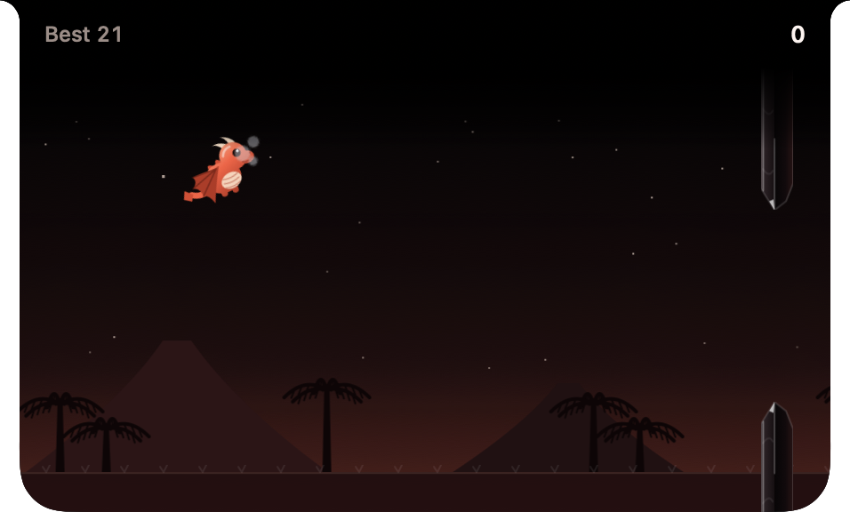

Click the notch, press **⌃⌥Space**, or choose **Play** from the flame icon in the menu bar, then steer Pip, a baby dragon learning to fly, through obsidian gates with
**Space**. Press **Esc** to fold the game back into the notch. While it's folded, it does nothing at all.

  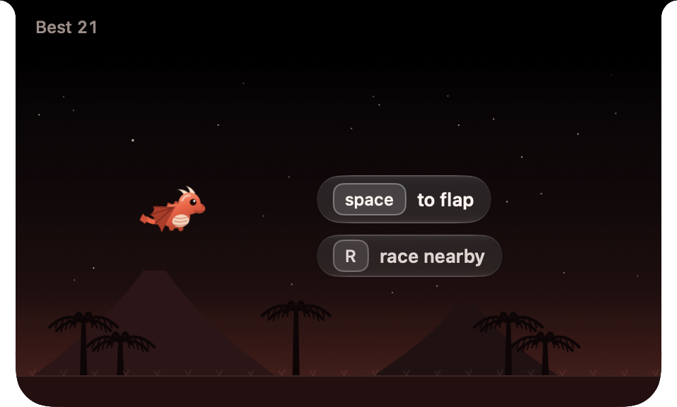
  &nbsp;
  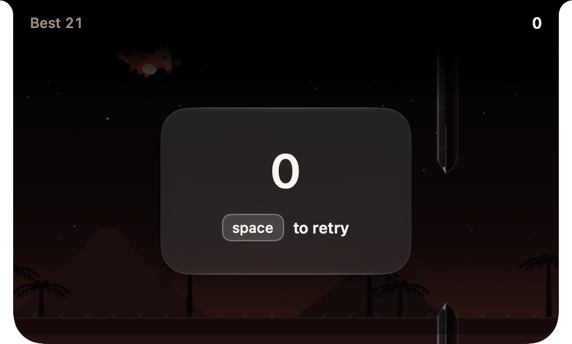

## How to play

| Key | Action |
| --- | --- |
| ⌃⌥Space | Open or fold the game, from any app |
| Space, ↑ or click | Flap (also starts a run after a 3-2-1, and retries after a crash) |
| P | Pause in place. P or Space resumes after a 3-2-1 |
| R | Race someone on your local network (on the idle screen) |
| Esc | Pause and fold. Switching to another app does the same |
| ⌘Q | Quit, while the game is open |

You score a point for every gate you pass. Every sixth gate is a **fork**: a floating chunk of obsidian splits the
gap, and each of the two openings holds something. Pick your opening.

| Power-up | Effect |
| --- | --- |
| Ember | Melts the next piece of obsidian you hit instead of ending the run. You can hold one at a time. It doesn't protect you from the ceiling or the ground. |
| Golden egg | +5 points. |
| Updraft | Lighter gravity for 5 s. |
| Feather | Bounces you off the ceiling or the ground once instead of ending the run. You can hold one at a time. |
| Tiny | You shrink to 70% for 5 s, so gaps are easier. |

| Power-down | Effect |
| --- | --- |
| Ash cloud | Smoke hides the field ahead for 4 s. |
| Stone scale | Heavier gravity for 5 s. |
| Hiccups | Random hops for 4 s. |
| Rush | The world speeds up by 30% for 4 s. |
| Bloat | You puff up to 130% for 5 s. |

Tiny and Bloat cancel each other out, and so do Updraft and Stone scale.

You can drag the island off the notch to float it anywhere.

## Heroes and maps

Pick who flies and where from the **Hero** and **Map** menus under the flame icon in the menu bar. Your choice is
remembered. It's art only: the rules are the same everywhere.

| | |
| :-: | :-: |
| 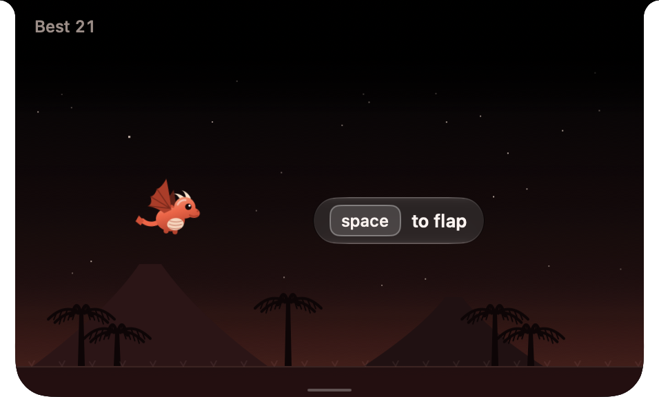 Pip in Ember Peaks | 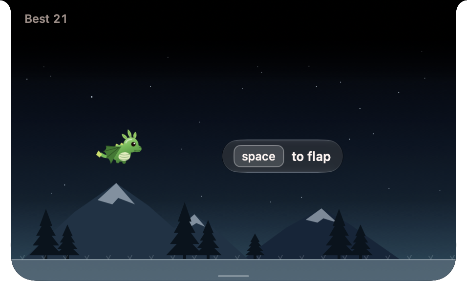 Moss in Glacier |
| 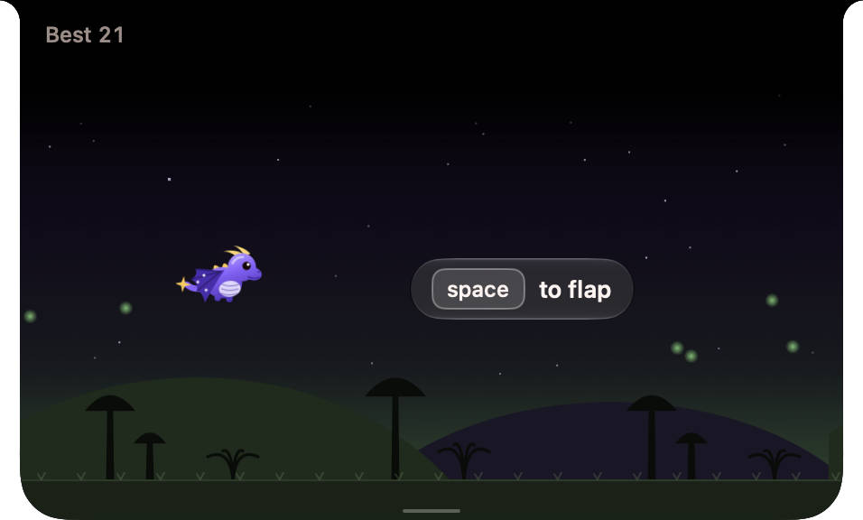 Nova in Night Grove | 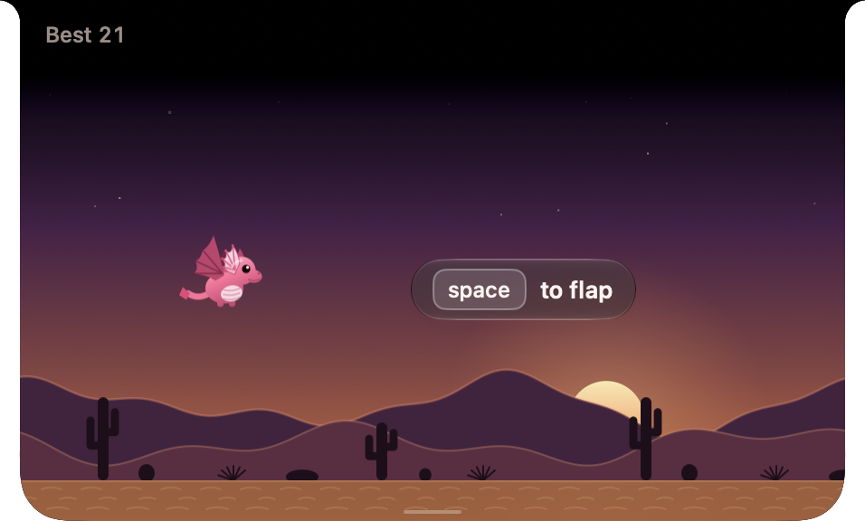 Coral in Dune Sea |
| 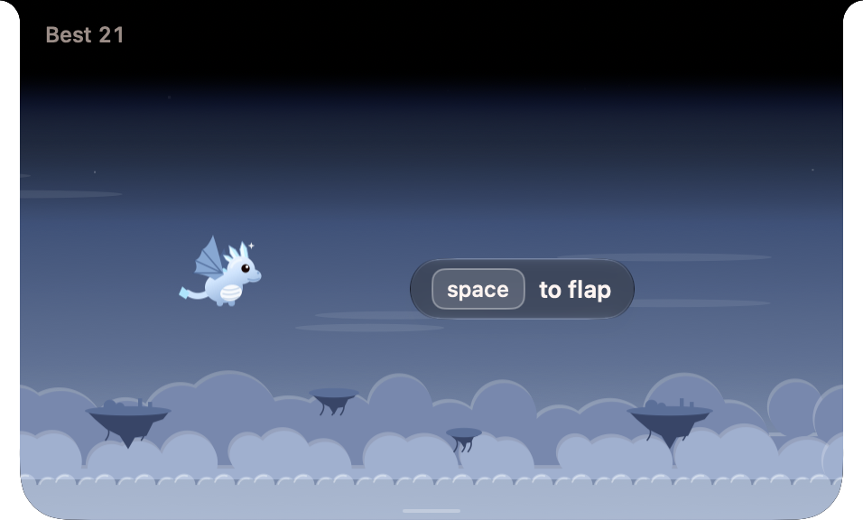 Frost in Sky Isles | 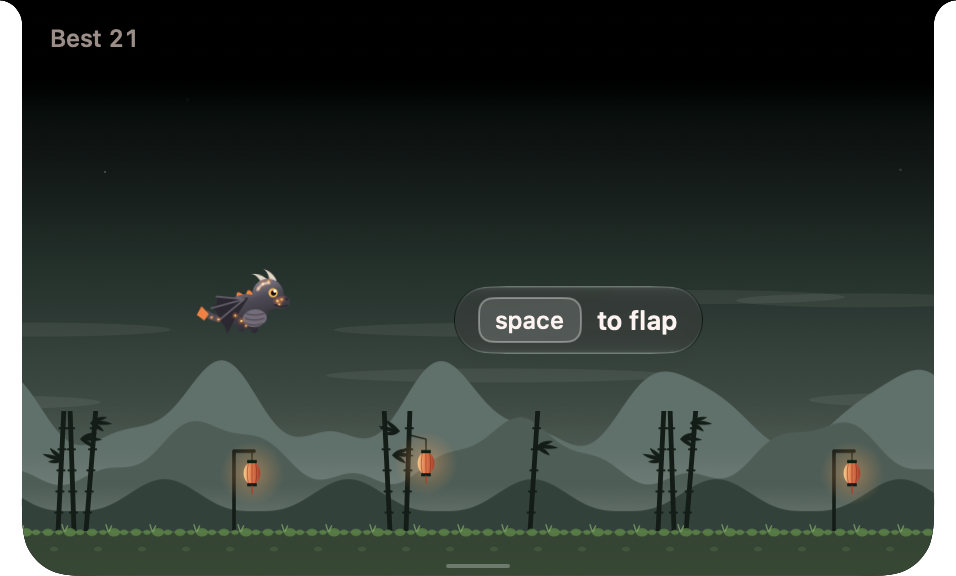 Sable in Bamboo Vale |
| 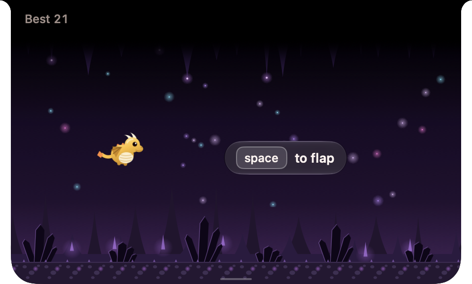 Saffron in Crystal Caves | 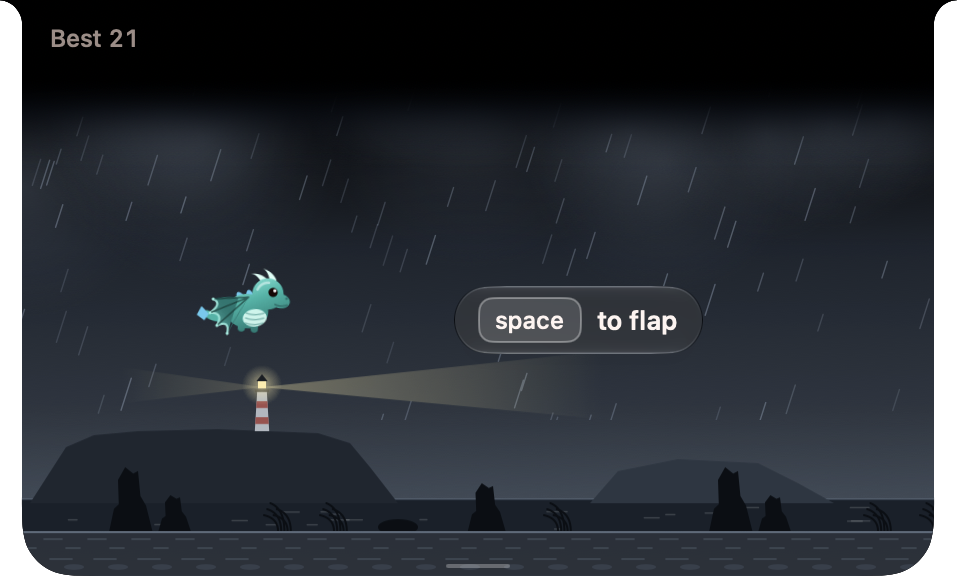 Tide in Storm Coast |
| 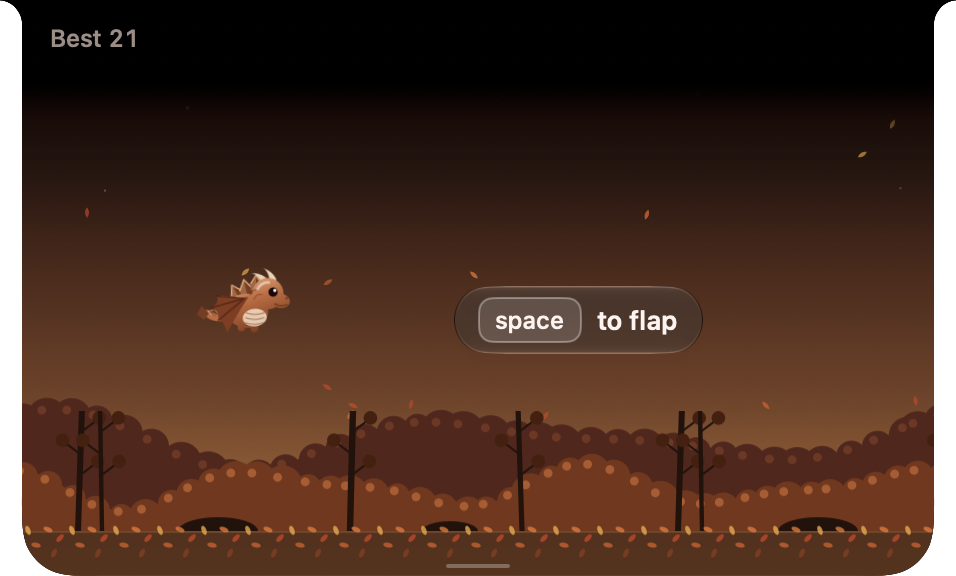 Rust in Autumn Woods | 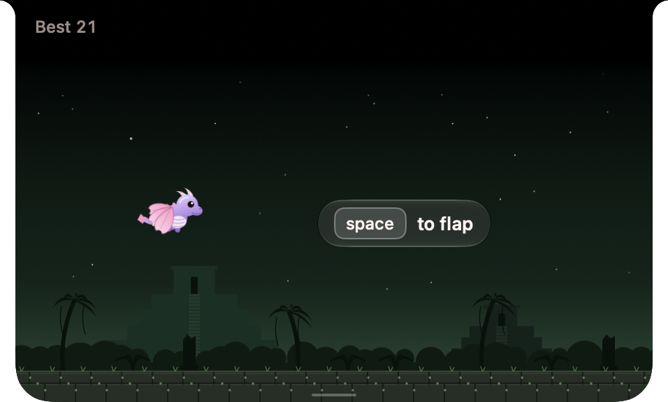 Blossom in Lost Ruins |

| Hero | Look |
| --- | --- |
| Pip | The red baby dragon. |
| Moss | Green, with a leaf crest. |
| Nova | Violet, with gold horns, starry wings and a star tail. |
| Coral | Pink, with frilled fin ears. |
| Frost | Pale blue-white, with crystal horns. |
| Sable | Charcoal, with glowing ember freckles. |
| Saffron | Golden yellow, with a round belly and stubby wings. |
| Tide | Teal, with webbed, fin-edged wings. |
| Rust | Copper, with plated back scales. |
| Blossom | Lilac, with petal-shaped wings. |

| Map | Obstacles |
| --- | --- |
| Ember Peaks | Obsidian among volcanoes and cycads. |
| Glacier | Ice crystals among snow-capped peaks and pines. |
| Night Grove | Thornwood trunks and mossy boulders among hills, mushrooms and fireflies. |
| Dune Sea | Sandstone pillars among sunset dunes and cacti. |
| Sky Isles | Rock spires with dangling roots, above the clouds. |
| Bamboo Vale | Bamboo bundles among misty hills and lanterns. |
| Crystal Caves | Amethyst clusters under a stalactite ceiling. |
| Storm Coast | Basalt columns in the rain, by a lighthouse. |
| Autumn Woods | Birch trunks under an orange canopy. |
| Lost Ruins | Vine-wrapped stone columns among jungle temples. |

## Racing

Two Macs on the same network can race the same course at the same time. Press **R** on the idle screen, or choose
**Race Nearby…** from the flame icon, then host a race or join one from the list. You see the other player as a
translucent ghost of their hero, on the host's map. The race runs until both dragons have crashed: the higher score
wins, golden eggs included, and equal scores tie.

| Key | In a race |
| --- | --- |
| Space | Flap. The host starts the race; on the result card, Space asks for a rematch |
| P | Pause both players. Only the player who paused can resume. 3 pauses each, 60 s at most |
| Esc | Fold while flying (this pauses the race). On a race panel, leave |
| N | Change your player name in the lobby (or Player Name… in the menu bar) |

Leaving, quitting or a lost connection ends the match for both players. Race scores never touch your solo best.
Racing needs the app bundle (see Build): macOS only asks for Local Network access for an app.

## Trust

- **No internet.** Racing talks only to one other Mac on your local network, and only while a race is open.
  No analytics, no accounts, no ads. Nothing listens or looks for other Macs until you press R or choose
  Race Nearby…, and it all stops when you leave the race.
- **No special permissions.** The global hot-key is registered with Carbon's `RegisterEventHotKey`, so the app only
  ever hears ⌃⌥Space. It doesn't ask for Accessibility or Input Monitoring access, and keys you press while the game
  is folded go straight to the app you're using.
- **Idle means idle.** While folded, the scene is paused. Measured over 30 s folded: 0.0% CPU, 0 wake-ups,
  about 36 MB of memory.
- **Open source.** Everything the app does is in `Sources/`.

## Build

Requires macOS 26 or later and Swift 6.2. Built on [NotchKit](https://github.com/neelrocketbots/notchkit).

    swift run NotchDino      # play
    swift test               # game rules and app logic

## License

MIT — see [LICENSE](LICENSE).
